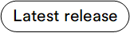

# Admin Shell

The **Admin Shell** is a new Vue-based back office for the Virto Commerce Platform, in preview alongside the existing AngularJS back office. It's built on a strangler pattern: a module's screen moves to Vue and takes its slot in a server-built menu. Every screen not yet migrated keeps running inside the shell in an embedded frame, with no break for day-to-day use.

!!! note
    Admin Shell is a preview release for testing and demos, not yet a replacement for the existing Backoffice.

## Key features

* A dozen-plus modules already have their own Admin Shell screens.
* Coexists with the AngularJS back office. 
* A screen not yet migrated to Admin Shell keeps working inside it through an embedded frame, so switching back offices doesn't hide any feature.
* Automatically switches between right-to-left and left-to-right layout for Arabic, Hebrew, Persian, and Urdu interface languages.

 
 
********

    <a href="../platform-overview">← Modules overview</a>
    <a href="../installing-admin-shell">Installing and using Admin Shell →</a>

