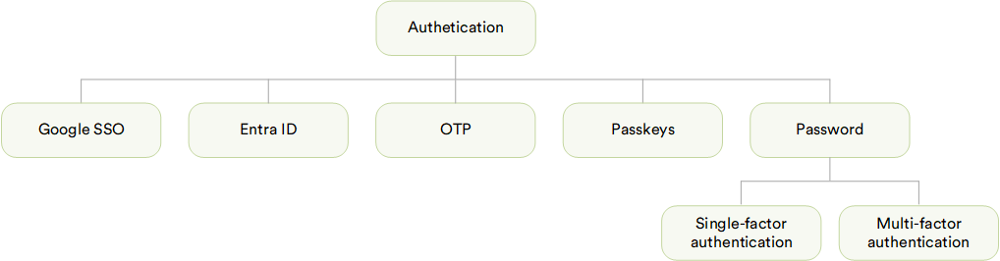

# Overview

Virto Commerce supports several ways for a user to sign in beyond a plain password. 

{: style="display: block; margin: 0 auto;" }

Each way is delivered as its own module, and each is configured differently:

* [Google SSO](google-sso/overview.md) and [Entra ID (previously Azure AD)](azure-ad/overview.md): sign in with an existing Google or Microsoft Entra ID account.
* [Passkeys](passkeys/overview.md): sign in with a fingerprint, face, screen lock, or security key instead of a password.
* [OTP](otp/overview.md): sign in with a one-time code emailed to the user instead of a password.
* [MFA](mfa/overview.md): require a one-time code as a second factor after a correct password.

!!! note
    Google SSO, Azure AD, and Passkeys replace the password at sign-in. They share one on/off switch per store: the **Authentication** widget. OTP also replaces the password, but is turned on separately in the store's own settings. MFA doesn't replace the password: it adds a code after it, and is also configured in its own settings.

 
 
********

    <a href="../file-system/overview">← File System Assets module overview</a>
    <a href="../google-sso/overview">Google SSO module overview →</a>

