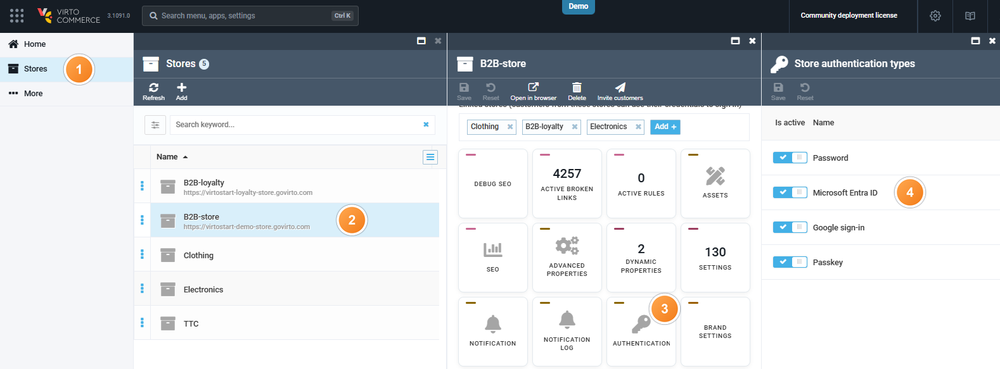
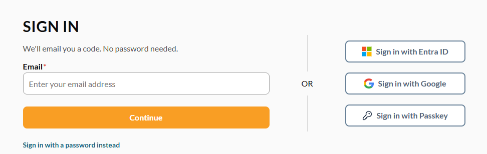

# Install and Enable Azure AD

Install the Azure AD module the same way as [other modules](/platform/user-guide/latest/modules-installation).

## Prerequisites

Before configuring the module, make sure you have:

* [Virto Commerce Platform, version 3.1076.0 or higher.](https://github.com/VirtoCommerce/vc-platform/releases/tag/3.1076.0)
* An application registered in Microsoft Entra ID, with its Application (client) ID and Directory (tenant) ID configured in the Platform.

{: width="25"} [Using Azure AD as SSO provider in the Platform](/platform/developer-guide/latest/Fundamentals/Security/extensions/adding-azure-as-sso-provider)

{: width="25"} [Using Azure AD as SSO provider on the Frontend](/storefront/developer-guide/latest/authentication/adding-sso-provider)

## Enable Azure AD for your store

To enable Azure AD sign-in for your store:

1. Click **Stores** in the main menu.
1. In the next blade, select your store.
1. In the next blade, click the **Authentication** widget.
1. In the **Store authentication types** blade, turn **Azure AD** on in the **Is active** column. Google SSO, Passkeys, and Password share the same widget.
1. Click **Save** in the toolbar.

{: style="display: block; margin: 0 auto;" }

Now, users can sign in with an existing Google account:

{: style="display: block; margin: 0 auto;" }

 
 
********

    <a href="../overview">← Azure AD module overview</a>
    <a href="../../otp/overview">OTP module overview →</a>

