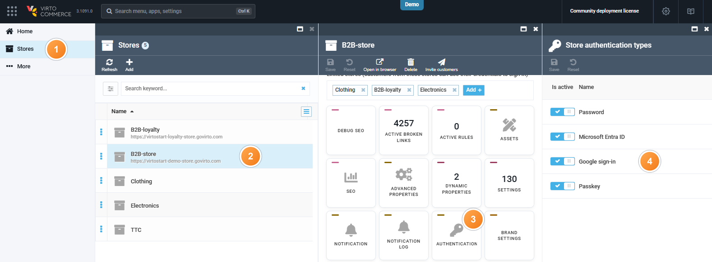
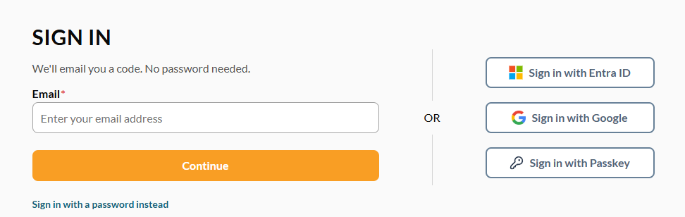

# Install and Enable Google SSO

Install the Google SSO module the same way as [other modules](/platform/user-guide/latest/modules-installation).

## Prerequisites

Before configuring the module, make sure you have:

* [Virto Commerce Platform, version 3.1076.0 or higher.](https://github.com/VirtoCommerce/vc-platform/releases/tag/3.1076.0)
* A Google OAuth 2.0 client ID and client secret, configured in the Platform.

{: width="25"} [Using Google as SSO provider in the Platform](/platform/developer-guide/latest/Fundamentals/Security/extensions/adding-google-as-sso-provider)

{: width="25"} [Using Google as SSO provider on the Frontend](/storefront/developer-guide/latest/authentication/adding-google-as-sso-provider)

## Enable Google SSO for your store

To enable Google sign-in for your store:

1. Click **Stores** in the main menu.
1. In the next blade, select your store.
1. In the next blade, click the **Authentication** widget.
1. In the **Store authentication types** blade, turn **Google** on in the **Is active** column. Azure AD, Passkeys, and Password share the same widget.
1. Click **Save** in the toolbar.

{: style="display: block; margin: 0 auto;" }

Now, users can sign in with an existing Google account:

{: style="display: block; margin: 0 auto;" }

 
 
********

    <a href="../overview">← Google SSO module overview</a>
    <a href="../../azure-ad/overview">Azure AD module overview →</a>

