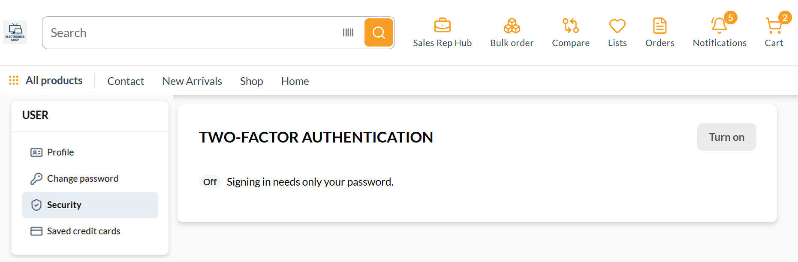
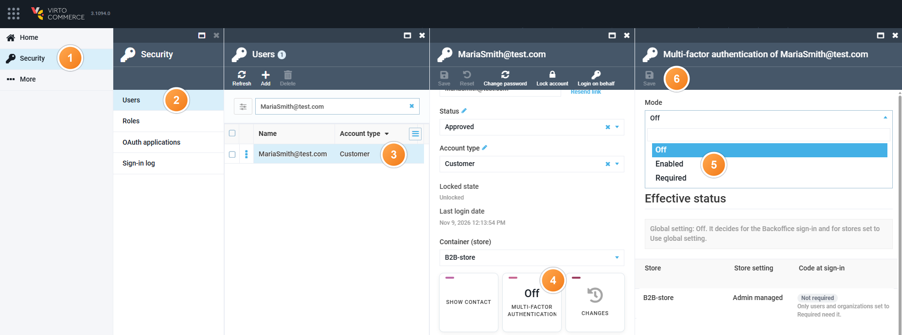
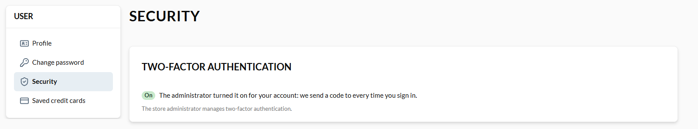

# Install and Enable MFA

Install the MFA module the same way as [other modules](/platform/user-guide/latest/modules-installation).

## Prerequisites

Before configuring the module, make sure you have:

* [Virto Commerce Platform, version 3.1090.0 or higher.](https://github.com/VirtoCommerce/vc-platform/releases/tag/3.1090.0)
* A confirmed email and enabled lockout for every user the module applies to. A user without a confirmed email or with lockout disabled cannot complete a sign-in that requires the code.

## Enable MFA globally

To require the code for every Backoffice sign-in, and for every password sign-in that does not name a store:

1. Click **Settings** in the main menu.
1. In the search field of the next blade, type **Multi-factor authentication** to find the settings related to the module.
1. Turn the **Multi-factor authentication** option on.
1. Click **Save** in the toolbar.

Backoffice and storeless sign-ins now require a one-time code sent by email, in addition to the password.

## Configure MFA for your store

To set a store's own mode:

1. Click **Stores** in the main menu.
1. In the next blade, select your store.
1. In the next blade, click the **Settings** widget.
1. In the search field of the next blade, type **Multi-factor authentication** to find the setting related to the module.
1. Select one of the following modes for multi-factor authentication:

    | Mode | Description |
    | --- | --- |
    | Use global setting | Follows the global **Multi-factor authentication** setting. |
    | Enabled | Requires the code from every customer of the store. |
    | Disabled | Does not require the code from the store's own customers. Backoffice accounts, and sign-ins without a store or to a store in another mode, still follow the global setting. |
    | AdminManaged | Requires the code only from the users and organizations an administrator sets to Required. |
    | CustomerChoice | Requires the code from the users and organizations with their mode set to **Enabled** or **Required**. Customers and organization maintainers turn it on and off for themselves on the [Frontend](/storefront/user-guide/latest/account/security#multi-factor-authentication).   {: style="display: block; margin: 0 auto;" }

1. Click **OK**, then **Save** in the toolbar to save the changes.

Your modifications have been applied.

### Assign MFA mode to users in admin managed and customer choice stores

In an **AdminManaged** or **CustomerChoice** store, an administrator sets the mode of a specific user or organization instead of the whole store:

1. Click **Security** in the main menu.
1. In the next blade, click **Users**.
1. Open the account the mode applies to.
1. Click the **Multi-factor authentication** widget.
1. Select one of the following modes: 

    | Mode | Description |
    | --- | --- |
    | Off | Not required in either an AdminManaged or a CustomerChoice store. The default. |
    | Enabled | Not required in an AdminManaged store. Required in a CustomerChoice store, where the customer can still turn it off in the Frontend. |
    | Required | Required in both an AdminManaged and a CustomerChoice store. Only an administrator can set it, and the Frontend cannot turn it off. |

    The blade also lists every store, whether the sign-in needs the code there, and why.

    !!! note
        A user's own mode has no effect while their organization's mode requires the code: the organization's requirement comes first, and the [Frontend](/storefront/user-guide/latest/account/company-info#multi-factor-authentication) hides the user's own switch. A user or organization mode only applies in a store set to AdminManaged or CustomerChoice; a store in any other mode, or a sign-in without a store, ignores it and follows its own mode or the global setting instead.

1. Click **Save** in the toolbar.

{: style="display: block; margin: 0 auto;" }

For example, after selecting **Required**, the [Frontend](/storefront/user-guide/latest/account/security#multi-factor-authentication) shows two-factor authentication as enabled for the user:

{: style="display: block; margin: 0 auto;" }

## Recover locked-out administrator

If an administrator can no longer sign in because of MFA, ask your development team to set `MultiFactorAuthentication:DisableEnforcement` to `true` in the Platform configuration and restart the Platform. Once the account or the settings are fixed, ask them to remove the switch.

{: width="25"} [MFA settings reference](/platform/developer-guide/latest/Configuration-Reference/appsettingsjson#multifactorauthentication)

 
 
********

    <a href="../overview">← MFA module overview</a>
    <a href="../../passkeys/overview">Passkeys module overview →</a>

