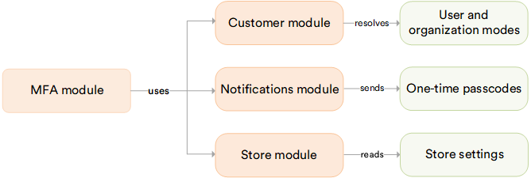

# Overview

The **MFA** module adds a second sign-in factor to password sign-ins: after the password, the user enters a one-time code sent by email. It covers the Backoffice and the storefront sign-in of every store.

The diagram below shows the MFA module dependencies:

{: style="display: block; margin: 0 auto;" }

## Key features

* Require the code from everyone, from no one, or leave the choice to users and organizations. Set the mode per Platform and per store.
* In a store that leaves the choice to customers, a customer and an organization maintainer turn the code on and off for themselves in the Frontend, under [Security](/storefront/user-guide/latest/account/security#multi-factor-authentication) or [Company Info](/storefront/user-guide/latest/account/company-info#multi-factor-authentication).
* An administrator can require the code for specific users or organizations, from a widget on their account or organization.
* A recovery switch in the [Platform configuration](/platform/developer-guide/latest/Configuration-Reference/appsettingsjson#multifactorauthentication) lets a locked-out administrator sign in again without the code.
* External sign-in (Google, Microsoft Entra ID, etc.) and OTP sign-in are not affected. MFA applies to password sign-ins only.

!!! note
    Before enabling MFA, confirm the email of the users it applies to and enable lockout for them. A user without a confirmed email or with lockout disabled cannot complete the sign-in.

 
 
********

    <a href="../../otp/overview">← OTP module overview</a>
    <a href="../enabling-mfa">Installing and enabling MFA →</a>

