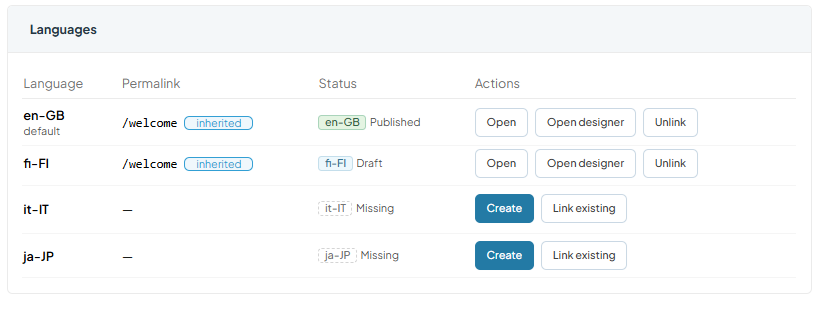

# Multilanguage Pages

A **Multilanguage page** is a single page with a separate Page Builder version for each language of the store. Every version has its own content, status, and design, while the name and the default settings belong to the shared page. A regular, single-language page is called a **Landing Page**.

## Prerequisites

Before configuring the module, make sure you have:

* [Page Builder module, version 3.1040.0 or higher.](https://github.com/VirtoCommerce/vc-module-pagebuilder/releases/tag/3.1040.0)
* [Pages module, version 3.1012.0 or higher.](https://github.com/VirtoCommerce/vc-module-pages/releases/tag/3.1012.0)
* [XCMS module, version 3.1009.0 or higher.](https://github.com/VirtoCommerce/vc-module-x-cms/releases/tag/3.1009.0)
* A store configured with more than one language.

## Create multilanguage page

To create a multilanguage page:

1. Click **Stores** in the main menu.
1. In the next blade, select your store
1. In the next blade, click the **Page Builder** widget.
1. Select **All pages** from the main menu.
1. Click **Add** in the toolbar, then select **Multilanguage page**.
1. Fill in **Name**, **Permalink**, and the **Default language**, and configure the **Advanced options**. These settings become the default for every language.
1. Click **Save**.

A multilanguage page appears in list of pages. Click this page to [manage language versions](#manage-language-versions).

!!! note
    In a store with only one language, **Add** opens the **Landing page** blade directly, with no page-type choice.

## Manage language versions

The **Languages** table lists **Language**, **Permalink**, **Status**, and **Actions** for every store language:

{: style="display: block; margin: 0 auto;" }

Each language shows one of the following statuses:

| Status | Description |
| --- | --- |
| Published | The version is live. |
| Draft | Content is saved but not published. |
| Missing | No version exists yet for this language. |
| Archived | The version is archived. |
| Outdated | The source language was published again after this translation was last updated. |

For a language that already has a version, that is, any status other than Missing, the available actions are:

* **Open** to edit the permalink and advanced options.
* **Open designer** to edit content.
* **Mark up to date**, and **Unlink** to turn the version back into a standalone landing page.

For a missing language, you can click:

* **Create** to add a draft copied from the default language
* **Link existing** to attach an existing landing page in that language. A linked page keeps its own permalink and settings and adopts the shared name.

## Inherited and custom settings

Permalink, visibility, user groups, organization, and the start and end dates are inherited from the **Multilanguage page** by default. A language version can override any of these fields, and the version blade marks each field as **Inherited** or **Custom**. Setting a field back to the parent value makes it inherited again.

When you change one of these settings on the multilanguage page while some languages already override it, a dialog asks how to apply the change:

* Apply to all languages, which resets the overrides.
* Apply to inheriting languages only, which leaves the overrides in place.
* Cancel.

## Publish, archive, and clone

In the toolbar, click **Publish All** to publish every draft language version at once. The default language publishes first, and a language with no draft is reported as skipped. **Archive All** archives every version the same way.

A multilanguage page without language versions can be deleted. One with versions must be archived first, the same as a landing page.

**Clone** copies every language version as a draft, adding "(copy)" to the name and "-copy" to the permalink in every language. Cloning the same page again uses the next free number instead of colliding with the earlier copy.

!!! note
    Saving a permalink already used by another active page in the same language asks for confirmation, since the Frontend serves one page per permalink and language.

## Outdated translations

Publishing the default language again starts a new revision. A translation already published, created, or marked up to date before that revision becomes **Outdated** until it is republished or marked up to date. Use **Mark up to date** for a source change that needs no translation.

## Convert landing page to multilanguage page

An existing landing page can become the default-language version of a new Multilanguage Page:

1. Open the landing page.
1. Click **Convert to multilanguage** in the toolbar.
1. Confirm your action.

The Landing Page becomes the default-language version, with no change on the Frontend. Add the other languages with **Create** or **Link existing** in the new **Languages** table.

## Multilanguage pages on the Frontend

Switching the language on a multilanguage page opens the matching translation's own permalink, instead of staying on the current URL. The page head also lists an **hreflang** link for every published translation, plus an **x-default** link pointing to the default language version.

If a visitor's language has no translation, the **Missing translation behavior** setting of the  Pages module decides the outcome: 

* **Default language** shows the default language version. This is the deault setting.
* **Not found** returns the page as not found. 

{: width="20"} [Pages module settings](../pages/settings.md)

 
 
********

    <a href="../manage-pages">← Managing pages via Content module</a>
    <a href="../manage-pages-via-office">Managing pages via Page Builder office →</a>

