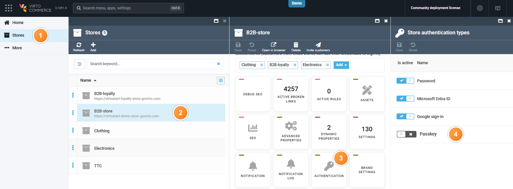
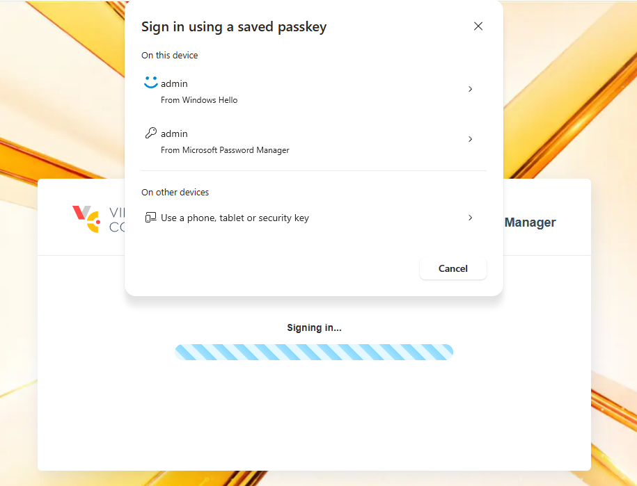

# Install and Use Passkeys

Install the Passkeys module the same way as [other modules](/platform/user-guide/latest/modules-installation).

## Prerequisites

Before configuring the module, make sure you have:

* [Virto Commerce Platform, version 3.1091.0 or higher.](https://github.com/VirtoCommerce/vc-platform/releases/tag/3.1091.0)

Passkey sign-in is on by default for every store and for the Backoffice once the module is installed.

## Disable passkeys for your store

To disable passkey sign-in for a store's Frontend:

1. Click **Stores** in the main menu.
1. In the next blade, select your store.
1. In the next blade, click the **Authentication** widget.
1. In the **Store authentication types** blade, turn **Passkey** off in the **Is active** column.

    

1. Click **Save** in the toolbar.

The sign-in page for that store now shows no passkey button, no passkey autofill, and no passkey section on the customer's account.

{: width="25" } [Passkey settings reference](/platform/developer-guide/latest/Configuration-Reference/appsettingsjson#passkey)

## Manage your own passkeys

A Backoffice user adds, renames, and deletes their own passkeys from their account the same way a customer or organization member does on the [Frontend](/storefront/user-guide/latest/account/security):

1. Click your name in the top right corner and select **Manage profile**.
1. Click the **Sign-in methods** widget.
1. Click {: width="20" } to add a passkey, then confirm with your fingerprint, face, screen lock, or security key. Which one you get depends on your device's enrolled sign-in methods and the save option you choose in the browser's prompt. Use the edit and delete icons next to an existing passkey to rename or remove it.

The next sign-in offers a **Passkey** option on the login page:

{: style="display: block; margin: 0 auto;" }

!!! note
    The last remaining way to sign in cannot be removed. A password can be removed once a passkey exists, and set again without the old password.

 
 
********

    <a href="../overview">← Passkeys module overview</a>
    <a href="../../back-in-stock/overview">Back-in-Stock module overview →</a>

