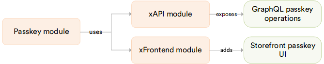

# Overview

The **Passkeys** module lets users sign in without a password, with a passkey: a fingerprint, face, screen lock, or security key. It works in both the Backoffice and the Frontend.

The diagram below shows the Passkeys module dependencies:

{: style="display: block; margin: 0 auto;" }

## Key features

* A user adds a passkey from their own profile, in the [Backoffice](../enabling-passkeys.md#manage-your-own-passkeys) or on the [Frontend](/storefront/user-guide/latest/account/security#add-passkey). The browser or device keeps the private key, and the Platform keeps only the public key.
* Users rename and delete their own passkeys from their list of sign-in keys.
* A passkey sign-in skips the one-time code from [MFA](../mfa/overview.md), since a passkey is already a strong second factor.
* The passkey button and passkey creation only appear in a browser that supports passkeys.
* A passkey is bound to the site it was created on: a Backoffice passkey does not work on a store's Frontend, and a Frontend passkey from one store does not work on another.
* A locked account is refused at passkey sign-in. A passkey sign-in does not clear earlier failed password attempts.
* A switch in the [Platform configuration](/platform/developer-guide/latest/Configuration-Reference/appsettingsjson#passkey) turns passkey sign-in off everywhere, in the Backoffice and on every store's Frontend.

## Passkey security

A passkey replaces a password with a key pair generated on the user's device. The private key never leaves the device, and the Platform stores only the public key.

* A passkey only works on the exact site it was created for, so even a convincing fake site cannot collect it. This makes passkeys resistant to phishing, unlike a password.
* A passkey is not a shared secret: a breach of the Platform's database exposes only public keys, which are useless without the matching private key on a user's device.

!!! note
    Recommend passkey sign-in to users whenever their device supports it. It removes the two most common ways a password gets stolen: a fake sign-in page and a leaked password database.

 
 
********

    <a href="../../mfa/overview">← MFA module overview</a>
    <a href="../enabling-passkeys">Installing and using Passkeys →</a>

