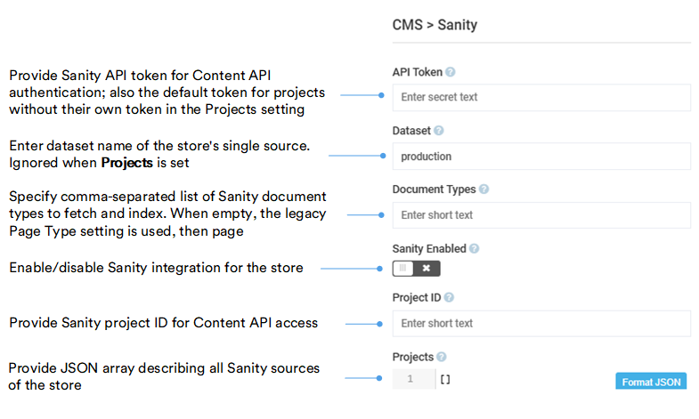

# Settings

To configure the store-specific module settings:

1. Click **Stores** in the main menu.
1. In the next blade, select your store.
1. In the next blade, click the **Settings** widget.
1. Type **Sanity** in the search bar to find settings related to the module.
1. Configure the following settings:

    {: style="display: block; margin: 0 auto;" }

1. Click **OK**, then **Save** in the toolbar to save the changes.

Your modifications have been applied.

!!! note
    An index rebuild started within 10 minutes of the previous one can skip documents from a type or source you just added, while the job still reports success. Wait 10 minutes after changing these settings, then rebuild again.

## Tokens as secrets

A token referenced as `${name}` resolves from a named secret your development team defines in the platform configuration. Ask your development team to add it, since this step is outside the admin UI. An unresolved `${name}` is never sent to Sanity: the project is skipped and a warning names the missing secret.

## Upgrade existing webhook

Earlier versions of the Sanity webhook were authorized by an API key in its URL. After upgrading the module, the webhook rejects every delivery until a secret is configured. Plan this change with your development team before you start:

1. In Sanity Manage, [set a strong random value](#tokens-as-secrets) in the webhook's **Secret** field.
1. Ask your development team to add the same value to the platform configuration and restart the platform.
1. Remove **api_key** and **storeId** from the webhook URL in Sanity Manage. Keep **cultureName** if you use it. The old URL without a signature is rejected.
1. Make sure every store that should receive the content lists its project and dataset in **Sanity.Projects** (or **Sanity.ProjectId** and **Sanity.Dataset**).
1. Save a document in Sanity Studio, then check the attempt log in Sanity Manage and the platform log for a **Sanity webhook request rejected** entry.

The webhook now accepts signed deliveries only.

 
 
********

    <a href="../overview">← Sanity module overview</a>
    <a href="../../contentful/overview">Contentful module overview →</a>

