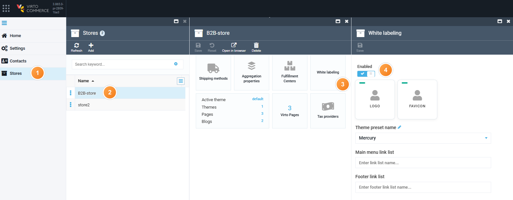
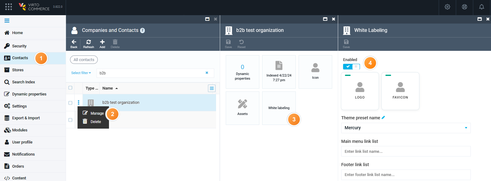
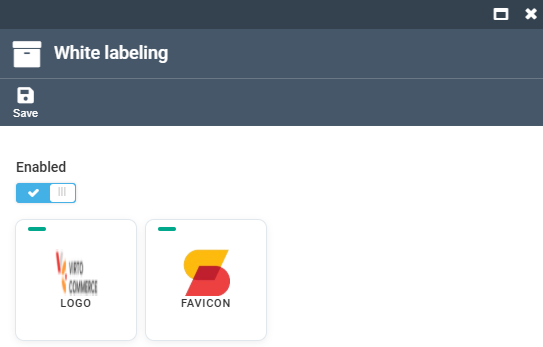
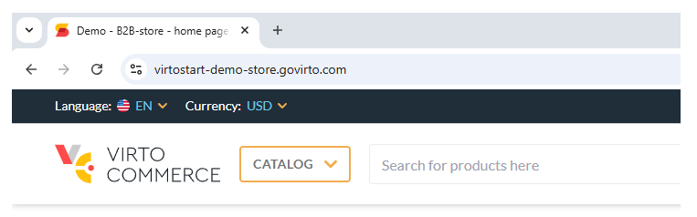
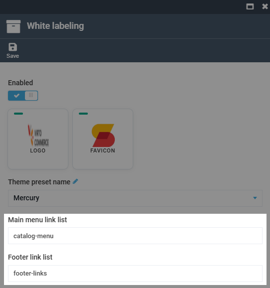
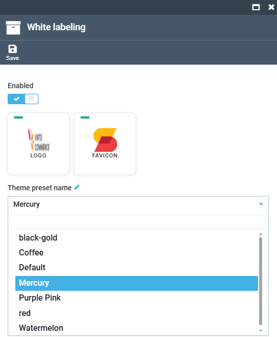

# Customize Brand Elements

White labeling can be scoped to a store or to an organization. Store-level white labeling, enabled via the **Stores** module, applies the brand elements to every visitor of that store. Organization-level white labeling, enabled via the **Contacts** module, applies the brand elements on the Frontend only to signed-in members of that organization, overriding the store's own branding for them.

Use organization-level white labeling when one store serves several B2B companies, for example a marketplace or reseller scenario, and each company needs its own logo, favicon, and colors without a separate store per company.

To start customizing brand elements:

1. [Enable white labeling feature via the Stores](customizing-brand-elements.md#enable-white-labeling-via-stores) or [the Contacts module.](customizing-brand-elements.md#enable-white-labeling-via-contacts)
1. [Customize logo and favicon.](customizing-brand-elements.md#customize-logo-and-favicon)
1. [Customize main menu and footer.](customizing-brand-elements.md#customize-main-menu-and-footer)
1. [Apply theme color scheme.](customizing-brand-elements.md#apply-theme-color-scheme)

## Enable white labeling via Stores

To enable white labeling via the **Stores** module:

1. Click **Stores** in the main menu.
1. In the next blade, select the desired store.
1. In the next blade, click the **White labeling** widget.
1. In the next blade, turn the white labeling option to on.

{: style="display: block; margin: 0 auto;" }

White labeling has been enabled.

## Enable white labeling via Contacts

To enable white labeling via the **Contacts** module:

1. Click **Contacts** in the main menu.
1. In the next blade, click the three dots to the left of the desired company.
1. In the next blade, click the **White labeling** widget.
1. In the **White Labeling** blade, turn the white labeling option to on.

{: style="display: block; margin: 0 auto;" }

White labeling has been enabled.

!!! note
    Organization branding normally activates after a member of the company signs in. If a custom domain is assigned to the organization, its branding activates on the first visit to that domain, before sign-in.

## Customize logo and favicon

To add own logos and favicon:

1. In the **White Labeling** blade, click the **Logo** widget to upload your company's logo.
1. Click the **Favicon** widget to upload your favicon.
1. Click **Save** in the toolbar, then click **Save** in the previous blade.

Your changes have been applied.

-    __Platform__

    

-   __Frontend__

    

## Customize main menu and footer

The **Main menu link list** and **Footer link list** fields in the **White Labeling** blade assign a link list, created in the Content module, as the store's or the organization's own main menu and footer.

1. [Create a link list in via Content](../content/managing-linklists.md), for example **catalog-menu** for the menu bar, or **footer-links** for the footer.
1. In the **White Labeling** blade, paste the link list's name into **Main menu link list** or into **Footer link list**.

    {: style="display: block; margin: 0 auto;" }

1. Click **Save** in the toolbar, then click **Save** in the previous blade.

Your menu or footer now follows the assigned link list.

!!! note
    These fields take priority over the store's own menu and footer sources. An empty **Main menu link list** falls back to the store's **Top level catalog linked list** setting, then to the menu generated automatically from catalog categories. An empty **Footer link list** falls back to a link list named **footer-links**. For organization-level white labeling via Contacts, an empty field falls back to the store's own white labeling value.

## Apply theme color scheme

To apply an existing color scheme:

1. In the **White labeling** blade, select one of the [available themes](../content/managing-themes.md#apply-theme-color-scheme) from the dropdown:

    {: style="display: block; margin: 0 auto;" }

1. Click **Save** in the toolbar.

The theme has been applied to the Frontend.

{: width="25"} [Adding custom themes](../content/managing-themes.md)

 
 
********

    <a href="../overview">← White Labeling module overview</a>
    <a href="../settings">Settings →</a>

