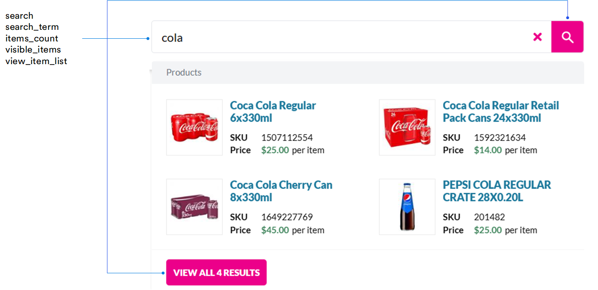

# Google Analytics Events

Google Analytics is used in the Virto Commerce Frontend Application to track user interactions and provide insights into user behavior. To make these insights more accessible for marketers, several preconfigured events are automatically sent to Google Analytics. You can view and analyze these events through Google Tag Manager (GTM).

{: width="25"} [GA integration](/platform/user-guide/latest/integrations/google-analytics/integration/)

{: width="25"} [Google Tag Manager setup for GA4](/platform/user-guide/latest/integrations/google-analytics/integration/#google-tag-manager-setup-for-ga4)

## Tracked sales funnel events

Sales funnel (checkout) events represent sequential steps that guide the customer from the shopping cart to completing the payment. These events help you understand where customers drop off and how efficiently your checkout flow works.

After the customer proceeds to checkout, the following events are tracked in the specified order:

| GA event         	    | Action (trigger)                                                                          | Checkout step                        |
|-------------------	|-------------------------------------------------------------------------------------------|----------------------------------------|
| begin_checkout    	| Click **Proceed to checkout**.                                                           	|                                         |
| add_shipping_info 	| Click **Proceed to billing** after specifying the shipping address and delivery method. 	| Shipping.                               |
| add_payment_info  	| Click **Review order** after specifying the billing address and the payment method.       | Billing.                                |
| place_order       	| Click **Place order** after reviewing the order.                                       	| Order review.                             |
| purchase          	| Click **Pay now** after selecting the payment method.            | Payment (unless manual payment was select at the previous step). |

!!! note
    For a single-step checkout, only `begin_checkout` and `place_order` are tracked. Other events can be added at the client's request.

## Events beyond the checkout funnel

Outside the checkout flow, Virto Commerce tracks various interaction events that describe how users search, browse, and interact with products. Unlike sales funnel events, these do not follow a specific order. Instead, they capture actions wherever the user is on the Frontend.

### Search events

When a user types a query into the search bar and submits it (presses **Enter**, clicks the magnifying glass icon, or selects **View all results**), several search-related events are triggered automatically.
These events help you analyze:

* What users search for.
* How many results they see.
* How many items are visible in the suggestions dropdown.
* Which product lists users view immediately after searching.



### Other Frontend interactions

The table below shows additional events that track user actions across the Frontend:

<table border="1" cellpadding="8" cellspacing="0">
  <thead>
    <tr>
      <th>GA event</th>
      <th>Action (trigger)</th>
      <th>Result</th>
      <th>Location</th>
    </tr>
  </thead>
  <tbody>
    <tr>
      <td>login</td>
      <td>Submit login form with valid credentials.</td>
      <td>User is logged into the storefront.</td>
      <td>Login page.<br>Popup login form.</td>
    </tr>
    <tr>
      <td>sign_up</td>
      <td>Submit registration form.</td>
      <td>User account is created.</td>
      <td>Registration page.<br>Registration popup.</td>
    </tr>
    <tr>
      <td rowspan="7">view_item_list</td>
      <td>Type query into the search bar.</td>
      <td>Dropdown list appears.</td>
      <td>Wherever search bar is present.</td>
    </tr>
    <tr>
      <td>Open product page → View related products (e.g. <b>Products related to this item</b>, <b>Customers bought together</b>).</td>
      <td>Related products widgets appear on product page.</td>
      <td>Related products widget on product page.</td>
    </tr>
    <tr>
      <td>Open product page → View variations.</td>
      <td>Product variations appear on product page.</td>
      <td>Product variations widget on product page.</td>
    </tr>
    <tr>
      <td>Open cart → View recently browsed products.</td>
      <td>Recently browsed products widget appears on cart page.</td>
      <td>Recently browsed products widget on cart page.</td>
    </tr>
    <tr>
      <td>Open product comparison page → View compared products.</td>
      <td>The list of products added for comparison appears on product comparison page.</td>
      <td>Product comparison page.</td>
    </tr>
    <tr>
      <td>Open catalog → View products in the catalog.</td>
      <td>The products from the catalog appear.</td>
      <td>Catalog.</td>
    </tr>
    <tr>
      <td>Open lists.</td>
      <td>The products lists appear.</td>
      <td>Lists.</td>
    </tr>
    <tr>
      <td>view_item</td>
      <td>Open product page.</td>
      <td>Product page opens.</td>
      <td>Product page.</td>
    </tr>
    <tr>
      <td rowspan="8">select_item</td>
      <td>Go to Catalog → Select any item from it</td>
      <td>Product page opens.</td>
      <td>Catalog</td>
    </tr>
    <tr>
      <td>Type query into the search bar → Select product from the dropdown</td>
      <td>Product page opens.</td>
      <td>Product page.</td>
    </tr>
    <tr>
      <td>Go to product page → Select item from the recommended products</td>
      <td>Product page opens.</td>
      <td>Recommended products widgets on product page.</td>
    </tr>
    <tr>
      <td>Go to product page → Select item from the related products.</td>
      <td>Product page opens.</td>
      <td>Related products widget on product page.</td>
    </tr>
    <tr>
      <td>Go to cart → Select item from the recently browsed products.</td>
      <td>Product page opens.</td>
      <td>Recently browsed products on cart page.</td>
    </tr>
    <tr>
      <td>Go to cart page → Select item from the products list.</td>
      <td>Product page opens.</td>
      <td>Product list on cart page.</td>
    </tr>
    <tr>
      <td>Go to lists → Select item from the list.</td>
      <td>Product page opens.</td>
      <td>Lists.</td>
    </tr>
    <tr>
      <td>Go to compare page → Select item from the compared products list.</td>
      <td>Product page opens.</td>
      <td>Product comparison page.</td>
    </tr>
    <tr>
      <td>view_cart</td>
      <td>Go to Catalog → Add products to cart → Open cart.</td>
      <td>Cart with product opens.</td>
      <td>Cart.</td>
    </tr>
    <tr>
      <td>add_to_cart</td>
      <td>Add products to cart.</td>
      <td>Products are added to the cart.</td>
      <td>Cart.</td>
    </tr>
    <tr>
      <td>remove_from_cart</td>
      <td>Remove item from cart.</td>
      <td>Products are removed from cart.</td>
      <td>Cart</td>
    </tr>
    <tr>
      <td>clear_cart</td>
      <td>Click <strong>Clear cart</strong>.</td>
      <td>The cart is empty.</td>
      <td>Cart</td>
    </tr>
    <tr>
      <td>update_cart_item</td>
      <td>Change product quantity or options in the cart.</td>
      <td>Updated item quantity or configuration.</td>
      <td>Cart.</td>
    </tr>
    <tr>
      <td>add_to_wishlist</td>
      <td>Add product to wishlist.</td>
      <td>The product is added to list.</td>
      <td>Category page.<br>Product page.</td>
    </tr>
    <tr>
      <td>view_search_results</td>
      <td>Submit a search query and open the full search results page.</td>
      <td>Search results page with matching products appears.</td>
      <td>Search results page.</td>
    </tr>
  </tbody>
</table>

## Product list and click tracking

Product list tracking runs through a beacon tracking engine. The engine generates `view_item_list`, `select_item`, and `view_item` from page markup. This lets Page Builder content, catalog lists, and plain HTML lists report to GA4 without custom analytics code.

!!! tip
    Inspect these events in the browser console:

    ```js
    window.dataLayer
      .filter(e => e[0] === 'event' && ['view_item_list', 'select_item', 'view_item'].includes(e[1]))
      .map(e => ({ event: e[1], params: e[2] }))
    ```

### List identifiers

Each surface sends a fixed `item_list_id`:

| Frontend surface | `item_list_id` | Notes |
|---|---|---|
| Page Builder products and predefined-product-list blocks | `products_block` | One event per block, each with its own items, even when two blocks share the id. |
| Page Builder products-carousel block | `products_carousel` | An untitled carousel omits `item_list_name`. |
| Page Builder favorite-products block | `favorite_products` | A block whose filter matches nothing sends no event. |
| Product page, recommended products | `recommended_products_<model>` | For example `recommended_products_bought-together`. `related_id` is the product id, and `related_type` is `product`. |
| Product page, related products | `related_products` | |
| Product page, variations | `variations` | Sends `view_item_list` only, never `select_item`. `related_id` is the parent product. |
| Cart, recently browsed | `recently_browsed_products` | |
| Your own HTML list | The value of `data-list-id`. | See [Custom list markup](#custom-list-markup). |

The Page Builder `demo-product-list` and `product-info` blocks do not send these events yet.

!!! note
    These surfaces still use the existing analytics calls, one event per view or click:

    1. Category pages.
    1. The search bar dropdown (`search_bar`).
    1. The comparison page.
    1. The wishlist page.
    1. Cart line items.

### Event timing

The following situations determine whether a `view_item_list` or `select_item` event is sent:

| Situation | What happens |
|---|---|
| A list renders, in or out of the viewport. | One `view_item_list`. |
| The window resizes, or the same products are added to cart, have their quantity changed, or are refetched. | No second event. |
| The viewport shows fewer cards than the list holds. | `items` still holds the whole list. |
| A paginated list, for example the variations table, moves to another page. | A new `view_item_list` with that page's items only. Returning to an earlier page sends it again. |
| A product link is clicked, Enter is pressed on it, or it is Ctrl-clicked. | One `select_item`. |
| A card image, a carousel arrow, the quantity control, add to cart, add to a list, or compare is clicked. | No `select_item`. |
| A card has no `data-product-id`. | The card still works. Its item has no `item_id`. |
| A single-hit barcode search redirects straight to the product page. | No `view_item_list`. On a store with [barcode scanner search](/platform/user-guide/latest/catalog/configuring-barcode-scanner-search) configured, one `view_item` there instead. |

### Custom list markup

Add the following markup to a Page Builder Text block, or to any page template, to report a plain HTML list to GA4:

```html
<div data-vc-track="product-list" data-list-id="my_list" data-list-name="My list">
  <div data-vc-track="product-card" data-product-id="example-id" data-product-sku="EXAMPLE-SKU" data-product-name="Example product" data-product-price="19.90">
    <a data-vc-track="product-link" href="/example-product">Example product</a>
    <span>$19.90</span>
  </div>
</div>
```

| Attribute | On | What it does |
|---|---|---|
| `data-vc-track="product-list"` | The list container. | Marks the list. `data-list-id` becomes `item_list_id`. |
| `data-vc-track="product-card"` | Each card. | Becomes one entry in `items`. |
| `data-vc-track="product-link"` | The link inside a card. | The only element whose click sends `select_item`. |
| `data-product-id`, `data-product-sku`, `data-product-name`, `data-product-price` | A card. | Map to the matching [item fields](#item-fields). |

A card can carry only `data-product-name` and `data-product-price`; its item then has no `item_id`. Editing the price on such a card sends a new `view_item_list` for that list, while a card with an id ignores a price edit.

## Ecommerce event payloads

Several events carry a structured ecommerce payload in `dataLayer`, following the GA4 ecommerce reference. Each payload sends an `items` array instead of a concatenated SKU string, along with an `items_count`. Order events also send a `transaction_id`.

### Item fields

Each object in an `items` array describes one product:

| Field | Type | Description |
|-------|------|-------------|
| `index` | Number | The zero-based position of the product in the list. |
| `item_id` | String | The product SKU. |
| `item_name` | String | The product name. |
| `brand` | String | The product brand. |
| `affiliation` | String | The store the product is sold through. |
| `currency` | String | The currency code, for example `EUR`. |
| `item_list_id` | String | The list identifier. Matches `item_list_id` in the event. |
| `item_list_name` | String | The list name. Matches `item_list_name` in the event. |
| `item_category` | String | The product category, when available. |
| `item_category2` | String | A secondary product category, when available. |
| `discount` | Number | The discount applied to the product. |
| `price` | Number | The product price. |
| `quantity` | Number | The quantity. |

!!! note
    `item_list_id`, `item_list_name`, `item_category`, and `item_category2` apply to list and catalog contexts. The `place_order` and `purchase` events send `index`, `item_id`, `item_name`, `affiliation`, `currency`, `discount`, `price`, and `quantity`.

### view_item_list payload

Pushed when a product list renders, for example the **Recently browsed** widget or a catalog grid. The payload reports the list and the products in it:

| Parameter | Type | Description |
|-----------|------|-------------|
| `item_list_id` | String | The list identifier, for example `recently_browsed_products`. |
| `item_list_name` | String | The list name, for example "Recently browsed". |
| `items` | Array | The products in the list. See [Item fields](#item-fields). |
| `items_count` | Number | The number of entries in `items`. |

!!! note
    The legacy `items_skus` string is no longer sent.

### place_order payload

Pushed when the customer places an order, from the `placeOrder()` handler on the Frontend:

| Parameter | Type | Description |
|-----------|------|-------------|
| `transaction_id` | String | The unique transaction identifier. |
| `currency` | String | The order currency code. |
| `value` | Number | The order total, excluding tax and shipping. |
| `shipping` | Number | The shipping cost, when known. |
| `tax` | Number | The tax amount, when known. |
| `items` | Array | The products in the order. See [Item fields](#item-fields). |
| `items_count` | Number | The number of entries in `items`. |

### purchase payload

Forwarded to GA4 when the purchase completes. The Frontend dispatches this downstream from `place_order` as the internal `purchased` event, and the event definition forwards the `transaction_id` and `items` to GA4:

| Parameter | Type | Description |
|-----------|------|-------------|
| `transaction_id` | String | The unique transaction identifier, forwarded to GA4. |
| `currency` | String | The order currency code. |
| `value` | Number | The order total, excluding tax and shipping. |
| `shipping` | Number | The shipping cost, when known. |
| `tax` | Number | The tax amount, when known. |
| `items` | Array | The purchased products. See [Item fields](#item-fields). |
| `items_count` | Number | The number of entries in `items`. |

<br>
<br>
********

<div style="display: flex; justify-content: space-between;">
    <a href="../../../authentication/authentication-types">← Authentication types </a>
    <a href="../../prerender_io/">Enhancing SEO with Prerender.io  →</a>
</div>