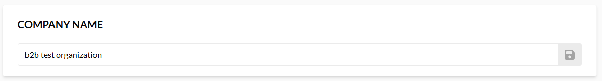
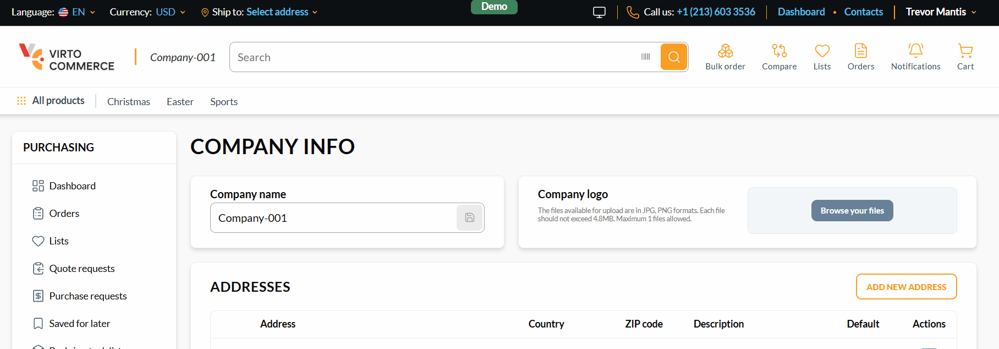
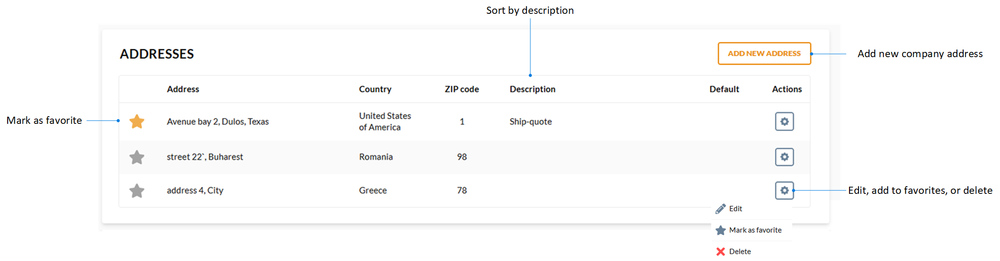

# Company Info

The **Company info** section contains the following widgets:

* **Company name** to edit and save company name:

    {: style="display: block; margin: 0 auto;" }

* **Company logo** (for admins) to upload, edit, or delete company logo in JPG and PNG format not exceeding 4.8 MB. Deleting the newly uploaded logo restores the default logo:
     
     
    
     
     

* **Addresses** to add, delete, or add company addresses to favorites, including billing and delivery addresses:

    {: style="display: block; margin: 0 auto;" }

    !!! info
        The favorite address will automatically appear at the top of the address list in the **Company Info** section and during checkout.

* **Multi-factor authentication** (for maintainers) to require a one-time email code, in addition to the password, for everyone in your company:

    1. Open the **Multi-factor authentication** widget.
    1. Turn the code on or off for your organization, if your store lets you choose.
    1. Confirm the change with the one-time code emailed to you.

    The widget now shows your company's updated status.

    !!! note
        While your organization requires the code, a member's own **Multi-factor authentication** switch in [their account](security.md#multi-factor-authentication) has no effect, and they cannot turn it off themselves.

 
 
********

    <a href="../points-history">← Points history</a>
    <a href="../company-members">Company members →</a>

