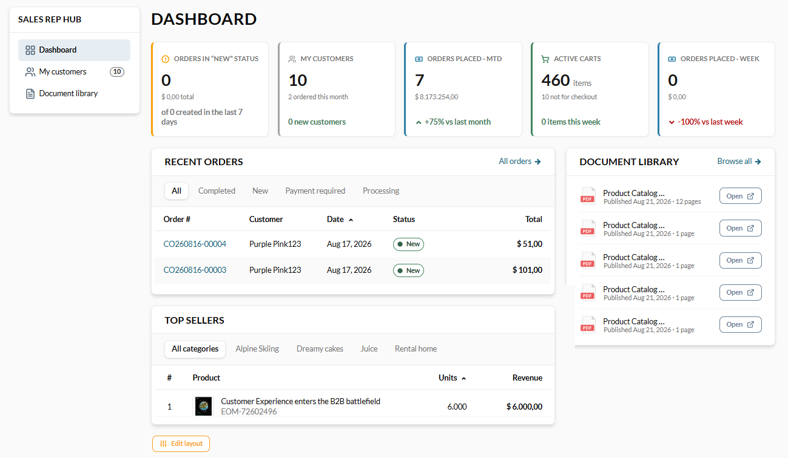
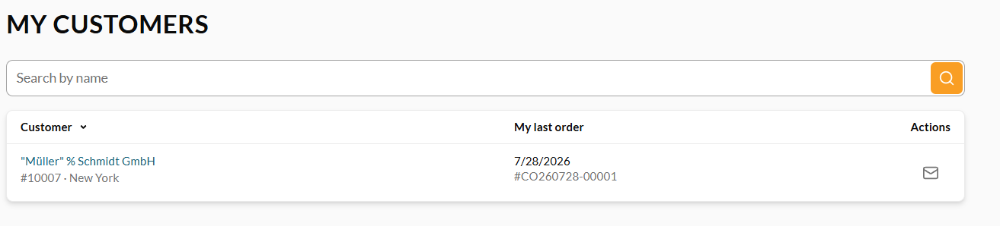
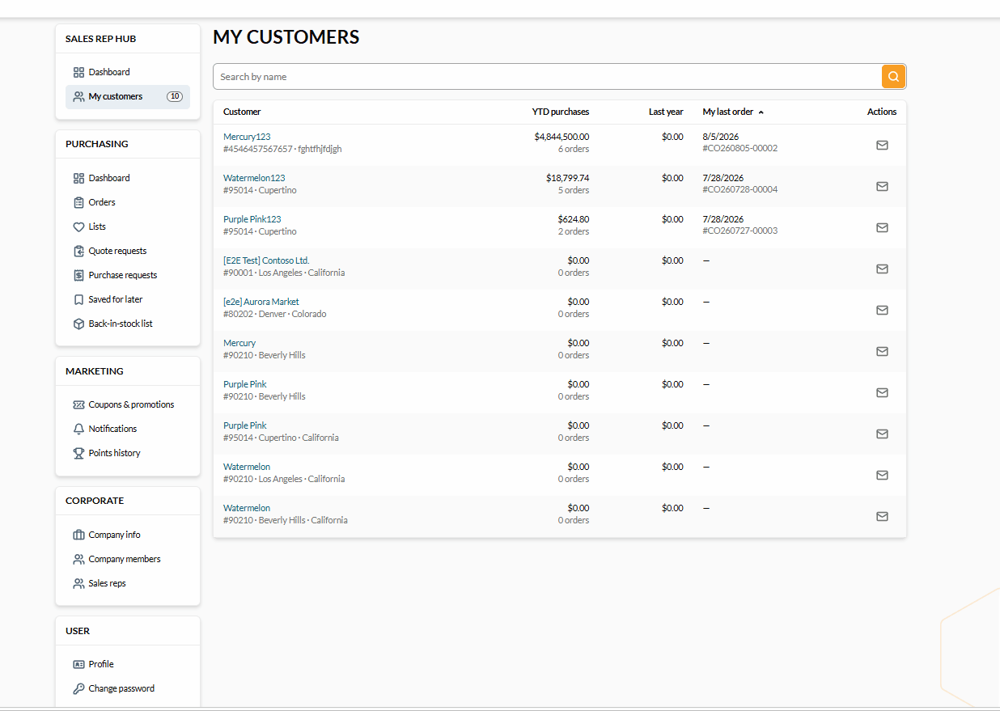
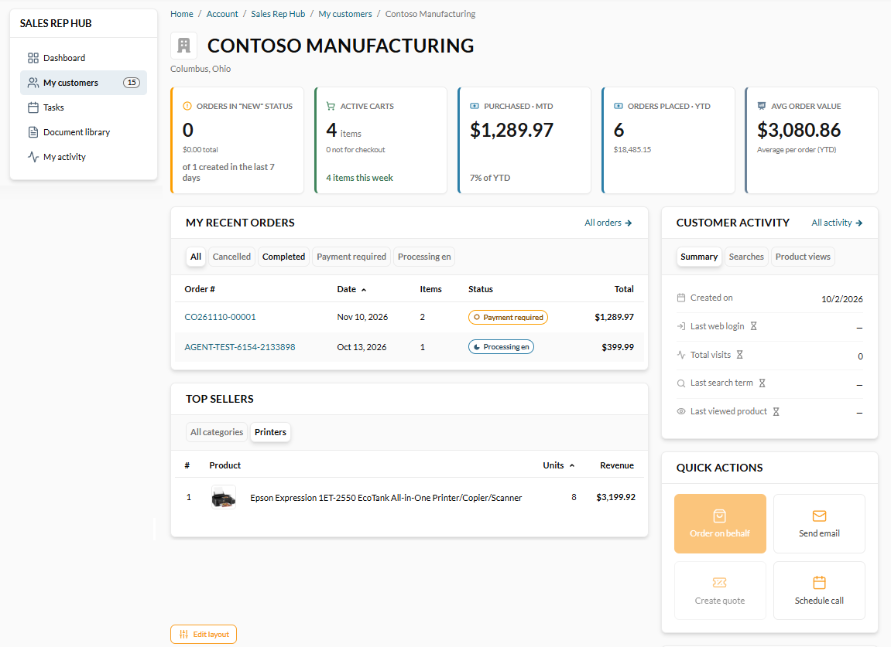
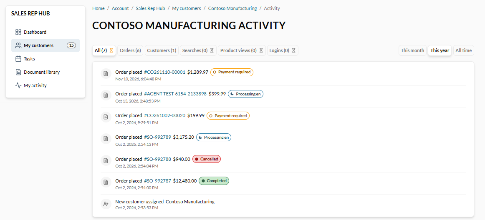
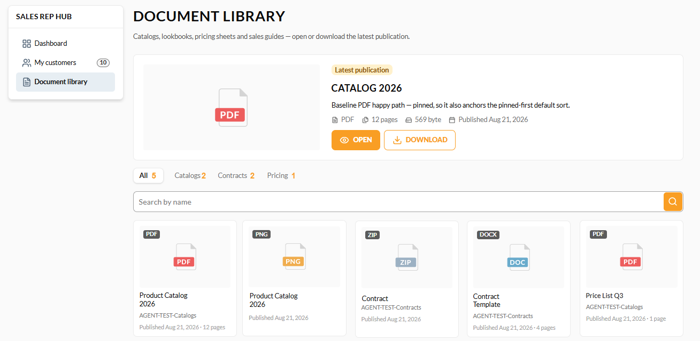
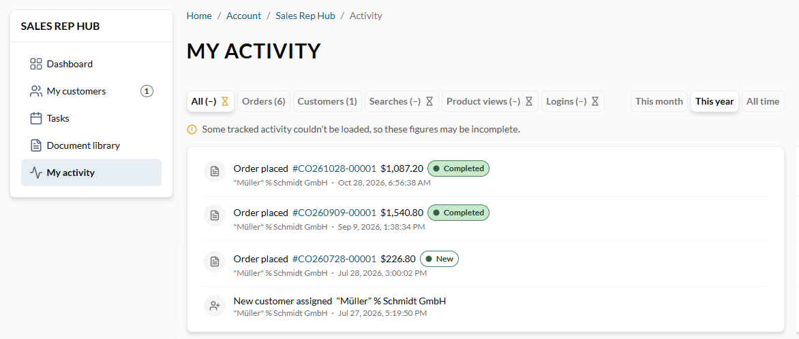

# Sales Rep Hub

The **Sales Rep Hub** is the workspace for sales representatives. It opens from the **Sales Rep Hub** section of the account menu and is available only to users who are sales reps. It gives a rep an overview of their assigned customers and orders, and access to shared sales materials.

## Dashboard

The **Dashboard** is the hub's landing page. It shows KPI cards summarizing the rep's activity, top selling products, and available documents: 

{: style="display: block; margin: 0 auto;" }

The dashboard can be edited by clicking **Edit layout** button:

* Stats widgets can be hidden or made visible again by dragging and dropping to the corresponding field.
* The number of recent orders and top sellers displayed can be set.
* The **Documents library** widget can be hidden and shown:

  
  

    <iframe loading="lazy" class="sl-demo" src="https://app.storylane.io/demo/qrchrtzewywg?embed=inline" name="sl-embed" allow="fullscreen" allowfullscreen style="position:absolute;top:0;left:0;width:100%!important;height:100%!important;border:1px solid rgba(63,95,172,0.35);box-shadow: 0px 0px 18px rgba(26, 19, 72, 0.15);border-radius:10px;box-sizing:border-box;"></iframe>
  

## My customers

The **My customers** page lists the customer organizations the rep is assigned to serve:

{: style="display: block; margin: 0 auto;" }

The customers can be edited as follows:

### Customer profile

Click a customer to open their profile. It shows the customer's orders and carts: orders in **New** status, active carts, purchased month to date, orders placed year to date, average order value, and the customer's recent orders:

The **Customer activity** widget on the same profile shows the customer's web activity from Google Analytics 4. 

The **Summary** tab shows the last login, the total number of visits, the last search term, and the last viewed product, and the **Searches** and **Product views** tabs show the full history. Click **All activity** to open the customer's own activity feed, the same page the [My activity](#my-activity) feed opens for a single customer.

!!! note
    The **Customer activity** widget needs the Google Ecommerce Analytics module connected to the store. Without it, the profile still shows the order and cart data above, but has no **Customer activity** widget, and **All activity** opens the customer's profile instead of their activity feed.

## Tasks

Sales reps can manage their tasks directly from the Sales Rep dashboard and track daily activities and customer follow-ups in the **Tasks** section:

  
  

    <iframe loading="lazy" class="sl-demo" src="https://app.storylane.io/demo/dkzn0sczr1nc?embed=inline" name="sl-embed" allow="fullscreen" allowfullscreen style="position:absolute;top:0;left:0;width:100%!important;height:100%!important;border:1px solid rgba(63,95,172,0.35);box-shadow: 0px 0px 18px rgba(26, 19, 72, 0.15);border-radius:10px;box-sizing:border-box;"></iframe>
  

## Document library

The **Document library** page lists the sales materials that are available to the rep with advanced permissions, for example product images, brochures, and price sheets.

The rep can browse and search the list, then open or download any accessible document. The uploaded documents are organized into categories. Supported file types are JPEG, PNG, ZIP, PDF, WEBP, XLS, TXT, and DOC:

{: width="20"} [Uploading documents to the library](/platform/user-guide/latest/sales-rep/document-library)

## My activity

The **Activity** section shows a merged, newest-first feed of what the rep's customers did: orders placed and customer assignments, plus, when analytics is connected, searches, product views, and sign-ins. Each category has its own tab with a counter, and the rep can filter the feed by customer, category, or date period:

{: style="display: block; margin: 0 auto;" }

!!! note
    The searches, product views, and sign-ins tabs need Google Analytics 4 connected to the store.

 
 
********

    <a href="../overview">← Personal and corporate accounts</a>
    <a href="../dashboard">Dashboard →</a>

