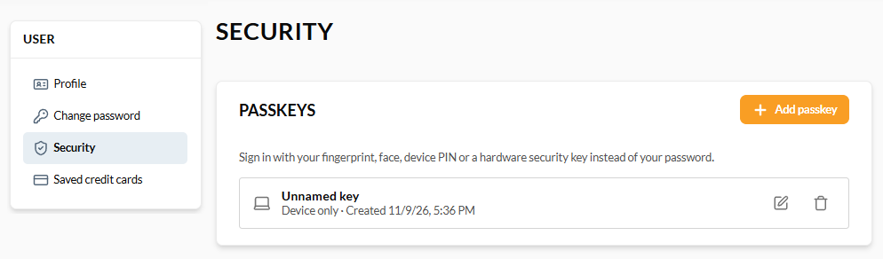
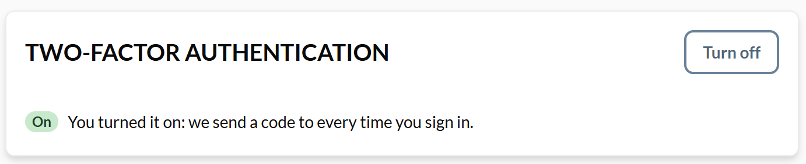

# Security

In the **Security** section, you can manage the passkeys used to sign in without a password: a fingerprint, face, screen lock, or security key. 

{: width="20"} [Passkeys module overview](/platform/user-guide/latest/passkeys/overview)

## Add passkey

To add a passkey:

1. Click **Add passkey**.
1. Confirm with your fingerprint, face, screen lock, or security key.

The passkey appears in the list with its name and creation date, and stays after you reload the page.

{: style="display: block; margin: 0 auto;" }

!!! note
    A device that already has a passkey for your account cannot add a second one. Use a different device instead.

## Sign in with passkey

Once you have a passkey, the [sign-in page](../registration_and_signing_in/sign-in.md) offers it as a sign-in option. A passkey works only on the store where you created it.

## Rename or remove passkey

To rename a passkey, click {: width="20"} next to it and enter a new name. 

To remove a passkey, click {: width="20"}, then confirm in the dialog.

!!! note
    Your last way to sign in cannot be removed.

## Multi-factor authentication

The **Two-factor authentication** widget shows whether your account needs a one-time email code after your password, in addition to the password itself. 

{: width="20"} [Enabling MFA for Storefront](/platform/user-guide/latest/mfa/overview)

If your store lets you choose:

* Click **Turn on** to enable two-factor authentication, 
* Click **Turn off** to disable the change with the one-time code emailed to you.

The widget shows your updated status.

{: style="display: block; margin: 0 auto;" }

!!! note
    Your email must be confirmed before you can turn multi-factor authentication on. If an administrator set your account to **Required**, or your organization requires the code, the switch is unavailable and you cannot turn it off yourself.

 
 
********

    <a href="../change-password">← Change password</a>
    <a href="../addresses">Addresses →</a>

